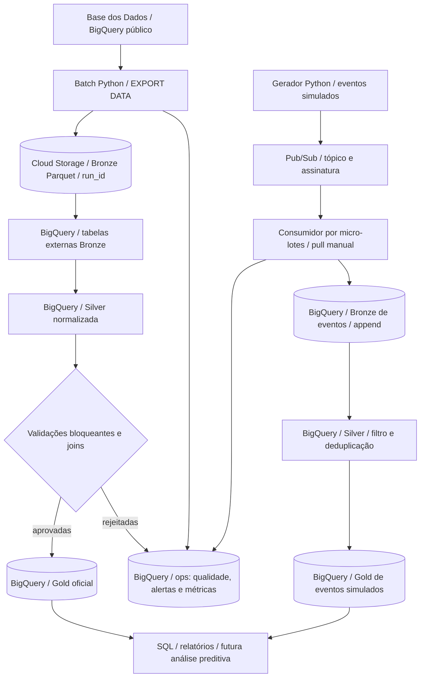

# Tech Challenge FIAP — Fase 2

## Pipeline híbrido para análise da alfabetização no Brasil

**Pós-Tech FIAP | Tech Challenge — Fase 2**  
**Equipe:** [INSERIR INTEGRANTES]  
**Repositório:** [INSERIR URL PÚBLICA DO GITHUB]  
**Vídeo executivo (até 5 minutos):** [INSERIR LINK DO VÍDEO]

> **Estado da entrega:** implementação disponível no repositório; **execução real no Google Cloud, validação do esquema da fonte, custos medidos e evidências ainda devem ser confirmados e adicionados pela equipe**. Não confundir código implementado com recursos efetivamente implantados.

---

## 1. Contexto e objetivo

O **Compromisso Nacional Criança Alfabetizada** busca assegurar a alfabetização até o fim do 2º ano do ensino fundamental. Segundo o enunciado do Tech Challenge, o Inep definiu, com a Pesquisa Alfabetiza Brasil (2023), **743 pontos na escala Saeb** como referência para considerar uma criança alfabetizada.

O objetivo técnico é criar uma **pipeline híbrida de Engenharia de Dados**, com ingestão **batch e streaming simulado**, integração de indicadores oficiais e metas educacionais, tratamento e validação de dados, disponibilização de uma camada analítica e registro de indicadores operacionais e financeiros na **Google Cloud Platform (GCP)**.

### Atenção à meta de 2030

- **80%:** meta *pactuada* para a rede pública na coluna `meta_alfabetizacao_2030` da fonte oficial, conforme o enunciado. As comparações na Gold usam **o valor de meta disponível em cada registro**, e não um valor presumido.
- **Universalização:** objetivo **aspiracional** da política pública, que **não deve ser confundido com a meta pactuada**.
- O projeto não considera um evento de simulação como resultado oficial.

### Fonte de dados

[Base dos Dados — Avaliação da Alfabetização](https://basedosdados.org/dataset/073a39d4-89cf-4068-b1e8-34ed0d9c0b72)  
**Projeto de origem no BigQuery:** `basedosdados`  
**Dataset:** `br_inep_avaliacao_alfabetizacao`

| Tabela oficial | Aplicação na pipeline |
|---|---|
| `alunos` | Microdados; contagem de registros agrupados para relacionar com indicadores territoriais |
| `municipio` | Resultados oficiais por município, ano, série e rede |
| `uf` | Resultados oficiais por unidade federativa |
| `meta_alfabetizacao_brasil` | Trajetória de metas nacionais publicada na Gold |
| `meta_alfabetizacao_uf` | Comparação com metas estaduais |
| `meta_alfabetizacao_municipio` | Comparação com metas municipais |
| `dicionario` | Referência oficial para interpretação de códigos e categorias |

As **seis entidades obrigatórias** estão contempladas no código, além da tabela auxiliar `dicionario`. A efetividade dos relacionamentos deve ser verificada após a primeira execução com dados reais.

---

## 2. Arquitetura



### Camadas da arquitetura medalhão

| Camada | Implementação no projeto | Política |
|---|---|---|
| **Bronze** | Parquet no Cloud Storage e tabelas externas BigQuery; eventos brutos em `bronze.eventos` | Cada batch grava um `run_id` novo no GCS; a tabela externa aponta para o snapshot mais recente. Eventos são acrescentados à tabela, inclusive quando duplicados ou inválidos. |
| **Silver** | Tabelas BigQuery com chaves normalizadas e campos de origem preservados | Os snapshots Silver são recriados no batch. Eventos passam por filtros e deduplicação por `event_id`. |
| **Gold** | Indicadores territoriais, metas nacionais, resumo de alunos, dicionário e eventos simulados | Publicação do batch ocorre após validações bloqueantes; eventos simulados ficam em tabela separada, identificados como não oficiais. |
| **Operacional (`ops`)** | `runs`, `metricas`, `qualidade`, `alertas` | Registros acumulativos para auditoria; não são substitutos de alerta externo configurado. |

**Batch versus streaming:** o batch captura snapshots históricos das tabelas públicas. O streaming simula atualizações por Pub/Sub e recebe mensagens em **micro-lotes acionados manualmente**. A entrada de eventos é incremental, mas o código atual **recria** as tabelas Silver e Gold de eventos a cada atualização; portanto, **não existe consumidor contínuo nem atualização analítica incremental por linha**. Essa é uma limitação consciente do protótipo.

---

## 3. Tecnologias e decisões arquiteturais

| Tecnologia | Finalidade | Justificativa |
|---|---|---|
| Python 3.10+ | Orquestração, publicação, consumo, regras e relatórios | Código reprodutível e bibliotecas oficiais GCP |
| BigQuery | SQL, Bronze externa, Silver, Gold e auditoria | Processamento gerenciado sem cluster permanente |
| Cloud Storage | Snapshots Bronze e exportação da Gold | Formato Parquet e preservação de histórico |
| Pub/Sub | Mensageria dos eventos simulados | Testes de reentrega e duplicação |
| Pytest | Testes automatizados de regras puras | Verificação local sem consumo de nuvem |
| Git/GitHub | Versionamento e entrega | Rastreabilidade do código e da documentação |

**Acesso à origem:** leitura direta das tabelas públicas no BigQuery, seguida de exportação para Parquet. Evita baixar manualmente os arquivos e favorece reexecução, mas consultas e exportações podem consumir recursos faturáveis. **Uma única nuvem** evita complexidade de IAM, faturamento e transferência entre provedores. Orquestração agendada, CI/CD, dashboards e infraestrutura como código **não estão implementados** neste pacote.

---

## 4. Estrutura do repositório

```text
fiap-alfabetizacao-gcp/
├── .env.example
├── .gitignore
├── README.md
├── pyproject.toml
├── requirements.txt
├── scripts/
│   ├── init_git.sh
│   ├── setup_gcp.sh
│   └── verificar.sh
├── src/
│   └── alfabetizacao/
│       ├── __init__.py
│       ├── batch.py
│       ├── cli.py
│       ├── cloud.py
│       ├── config.py
│       ├── finops.py
│       ├── gold.py
│       ├── quality.py
│       ├── schema.py
│       └── streaming.py
├── tests/
│   └── test_quality.py
└── docs/
    ├── roteiro-video.md
    └── evidencias/
        ├── .gitkeep
        └── LEIA-ME.md
```

Arquivos como `docs/esquema.json`, `docs/dry-run.json`, `docs/finops-medido.md` e evidências em JSON **só existirão após os respectivos comandos serem executados**. Prints e registros de execução devem ser incluídos manualmente na entrega.

---

## 5. Pré-requisitos e segurança

1. Projeto GCP com **faturamento habilitado** (crédito promocional pode cobrir consumo elegível).
2. Google Cloud Shell, Git, Python 3.10 ou superior, `pip` e acesso aos comandos `gcloud` e `bq`.
3. Permissões para executar jobs BigQuery, administrar os datasets próprios, gravar no bucket e criar tópico/assinatura Pub/Sub.
4. APIs habilitáveis de BigQuery, Cloud Storage e Pub/Sub.
5. **Orçamento e alertas de faturamento configurados** antes de ingerir os microdados.

**Segurança:** não versionar `.env`, credenciais JSON, tokens de webhook ou dados pessoais. O `.gitignore` protege esses itens comuns, mas o histórico Git deve ser revisado antes de publicar. Não subir microdados individuais para o repositório.

### 5.1 Clonar e instalar

No [Google Cloud Shell](https://shell.cloud.google.com/):

```bash
git clone https://github.com/SEU-USUARIO/fiap-alfabetizacao-gcp.git
cd fiap-alfabetizacao-gcp

python3 -m venv .venv
source .venv/bin/activate
python -m pip install --upgrade pip
pip install -r requirements.txt
pip install -e .

cp .env.example .env
nano .env
```

Variáveis de exemplo (substituir os identificadores, **não publicar o arquivo `.env`**):

```dotenv
GCP_PROJECT_ID=seu-projeto-gcp
BQ_LOCATION=US
GCS_LOCATION=us-central1
GCS_BUCKET=seu-bucket-globalmente-unico
PUBSUB_TOPIC=alfabetizacao-eventos
PUBSUB_SUBSCRIPTION=alfabetizacao-consumer
MAX_BYTES_BILLED=1073741824
MIN_JOIN_MATCH_RATE=0.80
ALERT_WEBHOOK_URL=
```

- `MAX_BYTES_BILLED`: teto por consulta, inicialmente **1 GiB**, que pode bloquear leituras grandes da origem; ajustar **somente depois do dry-run e da avaliação de custos**.
- `MIN_JOIN_MATCH_RATE`: mínimo inicial de **80%**; **parâmetro provisório**, que deve ser revisto e justificado com base nas taxas reais observadas.
- `GCS_LOCATION=us-central1`: opção de bucket regional compatível com tabelas externas no dataset BigQuery `US` e elegível às cotas gratuitas do Storage quando aplicáveis. Se já houver um bucket criado em `US`, o script **não altera** sua localização automaticamente.
- `ALERT_WEBHOOK_URL`: sem valor configurado, o erro permanece registrado em `ops.alertas`, mas **nenhuma notificação externa é enviada**.

### 5.2 Autenticação, testes e provisionamento

```bash
# Se a conta ADC não estiver disponível no Cloud Shell:
gcloud auth application-default login

bash scripts/verificar.sh
bash scripts/setup_gcp.sh

# Inspecionar recursos criados
gcloud config get-value project
gcloud storage buckets describe "gs://$(grep '^GCS_BUCKET=' .env | cut -d= -f2)"
```

O `setup_gcp.sh` habilita APIs, cria o bucket se não existir, inicializa datasets `bronze`, `silver`, `gold` e `ops`, cria tabelas operacionais e prepara Pub/Sub. Isso **provisiona recursos reais** e depende de permissões e créditos disponíveis; executar localmente os testes **não** comprova implantação em nuvem.

### 5.3 Inspecionar a origem e estimar consultas

```bash
python -m alfabetizacao.cli schema
cat docs/esquema.json

python -m alfabetizacao.cli dry-run
cat docs/dry-run.json
```

É obrigatório verificar os nomes, tipos e códigos realmente publicados. O módulo `schema.py` contém **candidatos de nomes**, não um esquema garantido. Caso a origem tenha mudado, ajustar os mapeamentos e documentar a decisão; não inventar códigos da rede/série ou substituir ausência de meta por zero.

> O `dry-run` estima bytes processados das sete tabelas; **não substitui a medição de execução**, e `LIMIT` não é uma estratégia de redução garantida de bytes lidos. Se algum scan ultrapassar o limite configurado, revisar a consulta e o recorte antes de aumentar o teto.

---

## 6. Executar ingestão batch

```bash
python -m alfabetizacao.cli batch
```

Etapas previstas no código:

1. Inventário dos sete esquemas e estimativa de bytes.
2. Exportação de cada tabela oficial para `gs://BUCKET/bronze/TABELA/run_id=.../part-*.parquet`.
3. Criação/atualização das tabelas externas `bronze` que leem o último snapshot.
4. Padronização das chaves na `silver`.
5. Verificação de nulos, duplicidade, faixas válidas e correspondência dos relacionamentos.
6. Publicação das tabelas Gold **somente depois das validações previstas**.
7. Persistência de métricas, resultados das regras e alertas em `ops`.

**Histórico:** o destino de cada ingestão tem `run_id` exclusivo e utiliza `overwrite=false`. Uma nova execução acrescenta objetos no GCS, sem apagar os anteriores. A atualização das tabelas externas Bronze usa `CREATE OR REPLACE` apenas nos *metadados de apontamento*, não nos snapshots armazenados. Silver/Gold do batch são reconstruídas, **sem histórico próprio garantido**.

Para provar preservação do histórico, após verificar custos, faça uma segunda execução e compare dois diretórios `run_id`:

```bash
python -m alfabetizacao.cli batch
# Substitua SEU_BUCKET pelo valor configurado
gcloud storage ls 'gs://SEU_BUCKET/bronze/municipio/'
```

### Produtos analíticos

| Tabela | Finalidade |
|---|---|
| `gold.indicador_municipio` | Resultado oficial, comparação restrita às metas municipais, referências de indicadores UF por rede correspondente e contagem de microdados |
| `gold.indicador_uf` | Resultado por UF; metas de rede Pública associadas somente ao mesmo recorte da fonte |
| `gold.metas_brasil` | Trajetória de metas nacionais |
| `gold.alunos_resumo` | Contagem agrupada dos microdados, sem interpretação como taxa de alfabetização |
| `gold.dicionario` | Dicionário oficial para consulta de categorias |

**Rigor analítico:** o cálculo de `distancia_pactuada_2030_pp` usa meta pactuada menos indicador oficial **no recorte disponível**. Meta ausente resulta em `sem_dado`, não em `nao_atingiu`. Não se publica média simples dos municípios como indicador nacional. O starter **não recalcula a taxa ponderada dos alunos**; isso demanda confirmar presença, peso amostral e denominador no dicionário oficial.

---

## 7. Executar streaming simulado

```bash
# O setup já prepara o Pub/Sub; este comando pode ser repetido
python -m alfabetizacao.cli pubsub-init

# Cinco eventos válidos e uma publicação duplicada
python -m alfabetizacao.cli publish --count 5 --duplicate
python -m alfabetizacao.cli consume --count 6

# Um evento inválido (indicador > 100): Bronze recebe, Gold exclui
python -m alfabetizacao.cli publish --count 1 --invalid
python -m alfabetizacao.cli consume --count 1
```

O produtor marca `origem=simulado`. O consumidor salva o payload bruto **antes de confirmar o recebimento** (*ack*), registrando cada entrega em `bronze.eventos`. O processamento valida campos obrigatórios, percentual de 0 a 100, data e município; filtra valores inválidos e deduplica por `event_id` para construir `gold.indicador_eventos`, com `categoria_fonte=nao_oficial`.

**Semântica:** Pub/Sub pode entregar uma mensagem mais de uma vez (*at least once*); a Bronze conserva as entregas, e o resultado analítico procura manter uma ocorrência lógica por evento. A latência observada é calculada a partir de `produced_at` e do momento de recebimento/ingestão, e **não é definida artificialmente como zero**.

Verificação SQL:

```bash
bq query --use_legacy_sql=false \
'SELECT event_id, origem, categoria_fonte, indicador, latencia_seg
 FROM `SEU_PROJETO.gold.indicador_eventos`
 ORDER BY ingested_at DESC LIMIT 20'
```

**Limitação:** a frequência depende do comando de consumo manual; não há serviço permanentemente ativo. O algoritmo atual refaz Silver/Gold dos eventos, embora consuma apenas as mensagens novas de cada micro-lote.

---

## 8. Regras de qualidade de dados

| Regra | Classificação | Efeito esperado |
|---|---|---|
| Nulos em chaves essenciais e ano, quando aplicável | Bloqueante | Não publicar Gold em caso de falha |
| Duplicidade no grão de junção/resultado | Bloqueante | Interromper publicação |
| Valores de indicadores fora de 0 a 100 | Bloqueante | Interromper publicação |
| Taxa de correspondência dos joins abaixo de `MIN_JOIN_MATCH_RATE` | Bloqueante | Interromper publicação |
| Evento simulado inválido | Informativa + exclusão analítica | Preservar payload em Bronze e excluir Silver/Gold |

O código registra as regras em `ops.qualidade` com nome, valor, limite, classificação e status. Para reproduzir **uma falha proposital**:

```bash
python -m alfabetizacao.cli quality-fail-demo
```

Este comando **deve terminar com status de erro** ao registrar uma taxa de join de 60%, abaixo do limiar de 80%, e também registrar um alerta. Não interpretar esse erro intencional como falha do ambiente. Essa demonstração valida o comportamento da regra; **a evidência adicional de bloqueio de publicação da Gold ainda deve ser coletada em execução controlada do batch**.

Confira os registros:

```sql
SELECT * FROM `SEU_PROJETO.ops.qualidade` ORDER BY checked_at DESC LIMIT 20;
SELECT * FROM `SEU_PROJETO.ops.alertas` ORDER BY momento DESC LIMIT 20;
```

**Cuidado com joins:** a pipeline mede correspondência no recorte de chaves disponíveis. Após o primeiro processamento, é necessário comparar os códigos da origem e confirmar se as dimensões `ano`, `rede` e `serie` representam o mesmo universo de dados em todas as tabelas. Não usar `COALESCE(...,0)` para mascarar metas e proficiências ausentes.

---

## 9. Observabilidade e alertas

Os registros operacionais são gravados no BigQuery, persistindo após a execução do terminal:

| Tabela | Informação registrada |
|---|---|
| `ops.runs` | Marcos de início e resultado de execuções batch; cada marco é uma linha |
| `ops.metricas` | Duração por etapa, status, bytes processados, linhas de saída quando disponíveis e ID de job |
| `ops.qualidade` | Resultado das validações bloqueantes e informativas |
| `ops.alertas` | Falha registrada e sinalizador de entrega do webhook |

O sistema detecta erros **durante a execução do comando**. Se `ALERT_WEBHOOK_URL` for configurada e testada, é feita uma tentativa de aviso no momento da falha. **Não há agendamento, monitoramento 24 horas ou SLA de detecção configurados**. Para produção, seriam necessários orquestração e alertas gerenciados (por exemplo, Cloud Scheduler/Run e Cloud Monitoring).

```bash
python -m alfabetizacao.cli evidence
```

O comando produz amostras JSON em `docs/evidencias/`. Também devem ser feitos **prints reais** de BigQuery, Cloud Storage, Pub/Sub, console de erros e métricas. Os prints precisam mostrar IDs e contagens verificáveis, sem revelar segredos ou informações pessoais.

---

## 10. FinOps — custos e medições

A arquitetura evita clusters sempre ligados, usa BigQuery sob demanda, snapshots Parquet e verificação prévia com `dry-run`. O limite `MAX_BYTES_BILLED` vale **por job**; não é um teto mensal de gastos. Créditos gratuitos ou estudantis **não substituem controle financeiro**.

Após pelo menos um batch real:

```bash
python -m alfabetizacao.cli finops
cat docs/finops-medido.md
```

O relatório usa bytes de processamento registrados e tamanho atual dos objetos GCS. A projeção considera **4 execuções batch/mês como hipótese explícita** e apresenta um **subtotal parcial**, não o custo de todos os componentes. Completar a tabela abaixo com medição do projeto e preços vigentes:

| Serviço | Unidade | Quantidade medida / origem | Preço unitário | Custo mensal projetado |
|---|---|---|---|---|
| BigQuery — consultas | TiB escaneados | **Preencher após `finops`** | Ver preço vigente da localização | **A medir** |
| BigQuery — armazenamento | GiB-mês | **Extrair do ambiente** | Ver preço vigente | **A medir** |
| Cloud Storage — objetos Bronze | GiB-mês | **Preencher após `finops`** | Ver preço vigente da localização | **A medir** |
| Pub/Sub — mensagens | GiB/mês | **Medir mensagens publicadas/consumidas** | Ver preço vigente | **A medir** |
| Operações e transferências | operações/GiB | **Conferir Billing e localizações** | Preço aplicável | **A medir** |

Fontes de preços: [BigQuery](https://cloud.google.com/bigquery/pricing) · [Cloud Storage](https://cloud.google.com/storage/pricing) · [Pub/Sub](https://cloud.google.com/pubsub/pricing) · [Calculadora GCP](https://cloud.google.com/products/calculator).

A ingestão é realizada na **GCP**, sem tráfego intencional entre nuvens. O bucket regional `us-central1` e os datasets BigQuery `US` são uma configuração possível para evitar movimentação de dados entre regiões incompatíveis. A seleção de localização deve ser validada no projeto antes da primeira exportação.

**Nota:** o custo mensal só poderá ser apresentado como **medido/projetado com evidência** depois de coletar os dados reais do ambiente. Não afirmar custo zero somente porque há crédito promocional.

---

## 11. Aplicação futura em Inteligência Artificial

A base Gold será preservada para a **Fase 3**, possibilitando análises de desigualdade territorial e modelos de predição de desempenho ou risco de descumprimento das metas. Uma possível abordagem é criar características históricas (`ano`, localidade, série, rede, resultados em anos anteriores) para prever o indicador em um período futuro, **sem utilizar informações ainda indisponíveis na data da previsão**.

**Prevenção de vazamento de alvo:** não usar a própria `distancia_pactuada_2030_pp` ou `status_meta_2030` como preditor de um rótulo derivado dessas colunas. Não usar eventos simulados para inferências sobre o Brasil real.

Exportação versionada da Gold:

```bash
python -m alfabetizacao.cli export-phase3
```

Destino previsto: `gs://BUCKET/gold/indicador_municipio/run_id=.../part-*.parquet`.

---

## 12. Evidências necessárias para a entrega

As evidências não foram produzidas automaticamente ao criar este repositório. Após executar no GCP, anexar, no mínimo:

- [ ] Tela dos datasets `bronze`, `silver`, `gold` e `ops` criados no BigQuery.
- [ ] Dois snapshots Bronze com `run_id` diferentes no Cloud Storage.
- [ ] Jobs reais BigQuery com IDs, sucesso/falha, volume e duração.
- [ ] Tabelas Gold com amostras e **contagens de linhas**.
- [ ] Tópico/assinatura Pub/Sub e evento duplicado ou inválido tratado.
- [ ] Gold de streaming com `origem=simulado` e latência real medida.
- [ ] Falha proposital de qualidade, registro persistido e bloqueio quando aplicável.
- [ ] Evidência de notificação externa configurada (webhook/alerta).
- [ ] Relatório `docs/finops-medido.md` preenchido com custos e premissas.
- [ ] Capturas sem credenciais/dados pessoais.
- [ ] Link de vídeo executivo de até **5 minutos** nesta página.

O [roteiro do vídeo](docs/roteiro-video.md) cobre problema, arquitetura, demonstração da solução, valor público e potencial de IA. As imagens, gráficos e números citados no vídeo devem corresponder à execução registrada.

---

## 13. Reprodutibilidade e publicação Git

A versão das dependências está declarada em `requirements.txt`. Antes de enviar ao GitHub:

```bash
bash scripts/verificar.sh

git status --short
git add README.md src scripts tests docs .env.example .gitignore requirements.txt pyproject.toml
git commit -m "docs: documenta arquitetura e execucao do Tech Challenge"
git push origin main
```

Em um **clone limpo**, refazer instalação, `.env`, testes, esquema, dry-run e ingestão para validar o passo a passo. Não versionar `.env`, tokens ou arquivos de chave. Verificar se os caminhos do README existem e se não há afirmações sobre CI/CD ou recursos não provisionados.

### Limitações conhecidas

- Schema e códigos da fonte pública ainda exigem **inspeção e validação real**.
- O processamento integral dos microdados pode exceder o teto inicial de 1 GiB por consulta.
- Streaming é **simulado** com consumidor acionado manualmente; Silver/Gold de eventos são recriadas.
- O nível mínimo de match de **80% é inicial** e precisa de calibração empiricamente justificada.
- A agregação de microdados publicada é contagem, **não taxa amostral ponderada**.
- Não há pipeline agendado, dashboard, CI/CD, Terraform, monitoramento gerenciado permanente ou política automatizada de retenção.
- Notificação externa depende de configurar e testar o webhook.
- A estimativa FinOps fornecida por script é parcial até complementar custos e cobranças reais do projeto.
- Execução em nuvem, evidências e link do vídeo **permanecem pendentes até serem produzidos**.

---

## 14. Referências

- **Material-base do projeto:** enunciado interno da FIAP, *Tech Challenge — Fase 2: Pipeline Híbrido para Análise da Alfabetização no Brasil* (PDF fornecido aos integrantes).
- [Base dos Dados — Dataset de Avaliação da Alfabetização](https://basedosdados.org/dataset/073a39d4-89cf-4068-b1e8-34ed0d9c0b72)
- [BigQuery — Documentação](https://cloud.google.com/bigquery/docs)
- [Cloud Storage — Documentação](https://cloud.google.com/storage/docs)
- [Pub/Sub — Documentação](https://cloud.google.com/pubsub/docs)
- [Google Cloud — Recursos gratuitos e teste](https://cloud.google.com/free/docs/free-cloud-features)

**Responsáveis pela entrega:** [INSERIR NOMES]  
**Última revisão:** [INSERIR DATA DA ENTREGA]
